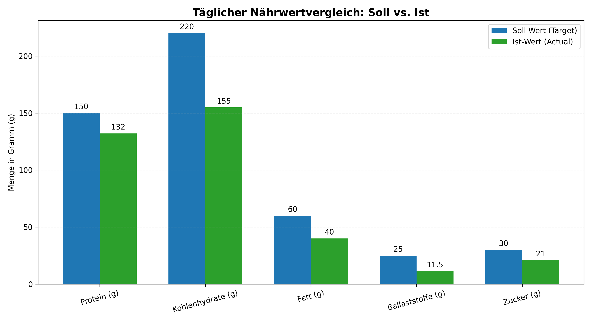

# NutriAgent – AI-Powered Nutrition & Hydration Tracker

Personal Python/Streamlit prototype for tracking meals and water consumption. Google Gemini interprets user-entered meals or food photos and produces **estimated** nutritional feedback; SQLite stores a user's daily report history.

> **Portfolio project / prototype.** Nutrient estimates can be wrong, particularly from photos or unfamiliar dishes. The app does not provide medical or dietetic advice and is not intended for production deployment with sensitive personal data.

## Features

- Register and sign in with local demo accounts (salted PBKDF2 password hashes).
- Configure age, height, weight and a fitness goal to calculate *illustrative* targets.
- Record meals by text or upload a photo for Gemini-based food recognition.
- Track daily water intake and compare estimated macronutrients with targets.
- Store meal summaries, water totals and estimated protein in local SQLite; view basic history charts.
- Optional separate command-line proof of concept (`main.py`) with a fictional example profile.

## Tech stack

Python, Streamlit, Google GenAI SDK (Gemini API), SQLite, Pandas, Pillow; Matplotlib and NumPy support the optional CLI plotting script.

## Architecture

```text
Streamlit UI (app.py)
 ├── Authentication + session state ── SQLite (local nutriagent.db)
 ├── Food text / photo ── Google Gemini API
 └── Daily summary + history ── SQLite + Pandas/Streamlit charts

Optional CLI prototype (main.py)
 ├── Example profile and targets (config.py)
 ├── Nutrition look-up helper (tools.py)
 └── Demo comparison chart (visualization.py)
```

## Run locally

Requires Python 3.10+ and a **separate Google Gemini API key** with access to the configured model.

```bash
git clone https://github.com/samanyousefi-Projekte/nutriagent-ai-nutrition-tracker.git
cd nutriagent-ai-nutrition-tracker
python -m venv .venv
```

Activate the environment:

- **Windows PowerShell:** `.\.venv\Scripts\Activate.ps1`
- **macOS/Linux:** `source .venv/bin/activate`

Install the libraries:

```bash
python -m pip install -r requirements.txt
```

Set the API key locally (do **not** commit it):

**Windows PowerShell:**

```powershell
$env:GEMINI_API_KEY = "PASTE_YOUR_OWN_KEY_HERE"
$env:GEMINI_MODEL = "gemini-3.8-flash"
streamlit run app.py
```

**macOS/Linux:**

```bash
export GEMINI_API_KEY="PASTE_YOUR_OWN_KEY_HERE"
export GEMINI_MODEL="gemini-3.8-flash"
streamlit run app.py
```

The default local URL is `http://localhost:8501`. The SQLite database is created automatically in the working folder and **must not be committed**.

To try the independent CLI demonstration with the same environment variables:

```bash
python main.py
```

**Note:** `main.py` currently plots hard-coded demonstration values after the model response; its chart is **not** a calculation derived from that response.

## Example visualization

The chart below shows **illustrative values** from the original CLI demonstration, not a live authenticated-user dashboard.



## Security and privacy

- API credentials are read from `GEMINI_API_KEY`, never stored in Python source.
- `.gitignore` excludes local databases, virtual environments, and secrets.
- Database queries use SQL parameters; demo passwords use per-user salted PBKDF2 hashes.
- Food images and meal descriptions submitted for AI analysis are sent to the Google Gemini API.
- Local account storage has **no rate limiting, password reset or production-grade session management**. Use this as a development prototype, **not as a publicly deployed multi-user health service**.
- The authentication format differs from the original prototype's unsalted SHA-256 hashes. Existing local accounts are **not migrated**; a fresh local database creates fresh demo accounts.

## Known limitations

- Nutrition reference data in `tools.py` covers only a small set of foods. Unknown foods do **not** receive invented default macros.
- Image recognition, portion estimation and AI-generated daily nutrient totals can be inaccurate.
- Only selected metrics are persisted (meals, water and protein), not a full longitudinal profile.
- Profile input and the current day's draft live in Streamlit session state, not in the persistent user table.
- SQLite in a local deployment is not suitable for persistent user data on temporary cloud hosts.
- Gemini model availability, quotas and billing depend on your Google API project; the configured model can be changed with `GEMINI_MODEL`.

## Author

Saman Yousefi — Master's student, Digital Technologies

[GitHub profile](https://github.com/samanyousefi-Projekte) · [LinkedIn](https://linkedin.com/in/saman-yousefi-4b68ba322)
